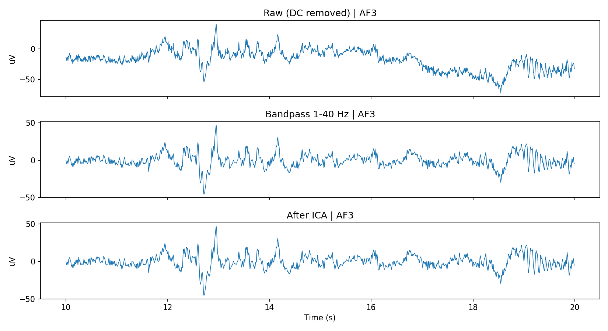
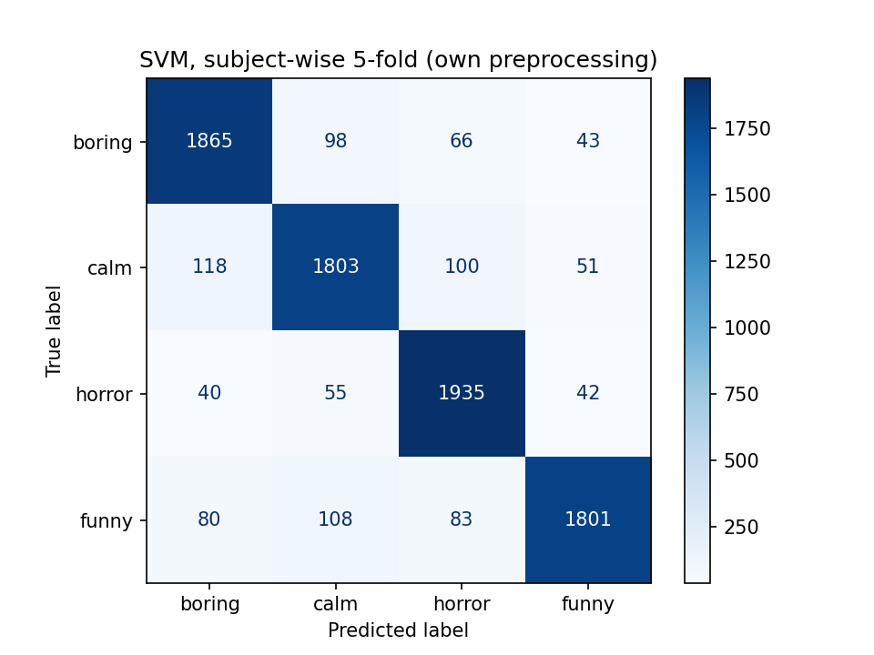

# EEG-based game-condition classification on GAMEEMO

End-to-end EEG pipeline on the GAMEEMO dataset (28 subjects, 14-channel Emotiv EPOC+):
raw EEG loading, filtering, ICA artifact removal, epoching, band-power features, and
SVM / Random Forest / 1D-CNN classifiers with subject-wise evaluation.

**Dataset:** Alakus, Gonen, Turkoglu (2020), *Database for an emotion recognition system
based on EEG signals and various computer games - GAMEEMO*, Mendeley Data,
DOI 10.17632/b3pn4kwpmn.3. Not included in this repo.

**Task:** 4-class classification of the game condition (G1 boring, G2 calm, G3 horror,
G4 funny; games: Train Sim World, Unravel, Slender: The Arrival, <G4 game name>).
Chance level = 25%.

## Pipeline
1. Load raw CSVs (14 channels, 128 Hz), remove DC offset, set 10-05 montage
2. Band-pass 1-40 Hz
3. ICA (14 components, ocular components chosen with AF3/AF4 as EOG proxy)
4. 4-s non-overlapping epochs (8,288 epochs)
5. Features: log band power (delta, theta, alpha, beta, gamma) x 14 channels (DE approximation)
6. Per-subject feature normalization
7. Models: SVM (RBF), Random Forest, 1D-CNN; subject-wise 5-fold CV (GroupKFold)

## Results
**Table 1: SVM, effect of preprocessing and per-subject normalization**

| Preprocessing | With subject-norm | Without |
|---|---|---|
| Authors' preprocessed data | 0.952 | 0.489 |
| Own: 1-40 Hz filter only | 0.960 | 0.497 |
| Own: filter + ICA | 0.893 | 0.483 |

**Table 2: Model comparison (with subject-norm)**

| Preprocessing | SVM | Random Forest | 1D-CNN (mean ± sd over folds) |
|---|---|---|---|
| Authors' preprocessed | 0.952 | 0.856 | 0.623 ± 0.223 |
| Own: filter + ICA | 0.893 | 0.768 | 0.633 ± 0.191 |

**Observations**
- Per-subject normalization raised SVM accuracy from ~0.49 to 0.89-0.96.
- ICA lowered accuracy vs filter-only (0.893 vs 0.960). Possible reasons (not tested):
  informative components removed, or class information partly carried by ocular/muscle activity.
- 1D-CNN did not beat SVM on band-power features and varied a lot across folds.
- Random vs subject-wise split (RF): ~11-point gap with own preprocessing
  (0.875 vs 0.768), none with the authors' data (0.863 vs 0.856).

## Limitations
- Labels are game conditions, not SAM-rated emotion. Games differ in visuals and motor
  activity, so the classifier may use more than affect.
- Subject-norm uses each test subject's unlabeled data from all 4 conditions; real use
  would need a per-subject calibration recording.
- No EOG channel, so ICA components were chosen via a frontal-channel proxy;
  FastICA did not converge on some files.
- 14-channel consumer-grade EEG, 28 subjects, single seed, no hyperparameter tuning.
- Healthy game-play data, not clinical anxiety/depression data.

## How to run
1. Download GAMEEMO from Mendeley Data and put it where the notebook expects it
   (the notebook was run on Kaggle with the dataset under `/kaggle/input`).
2. `pip install -r requirements.txt`
3. Run `gameemo_pipeline.ipynb` top to bottom (GPU recommended for the CNN section).